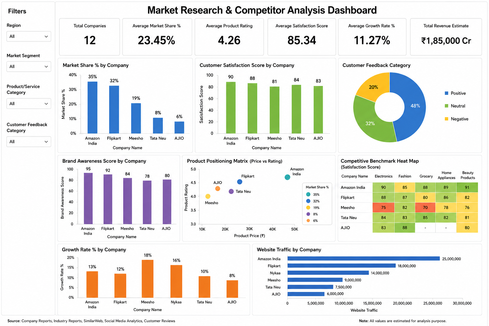
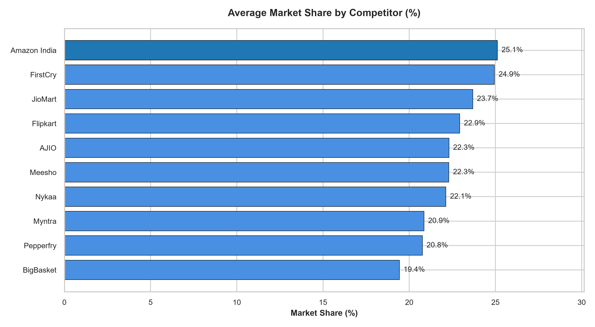
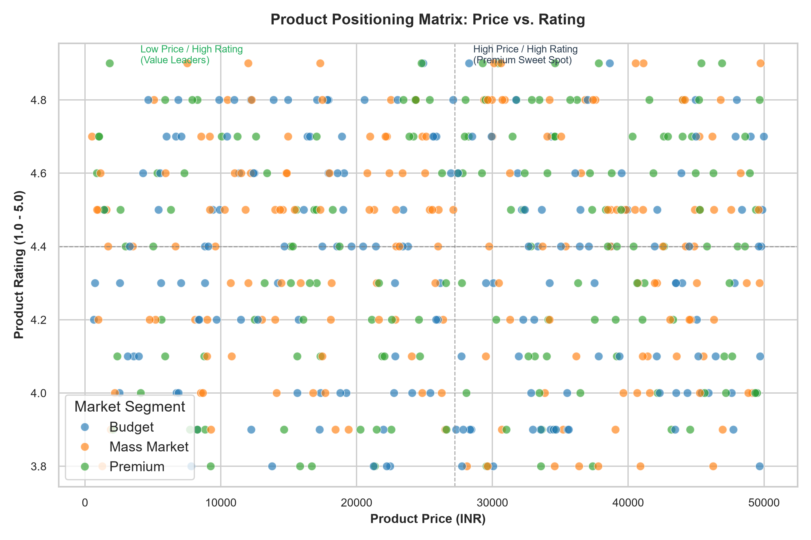
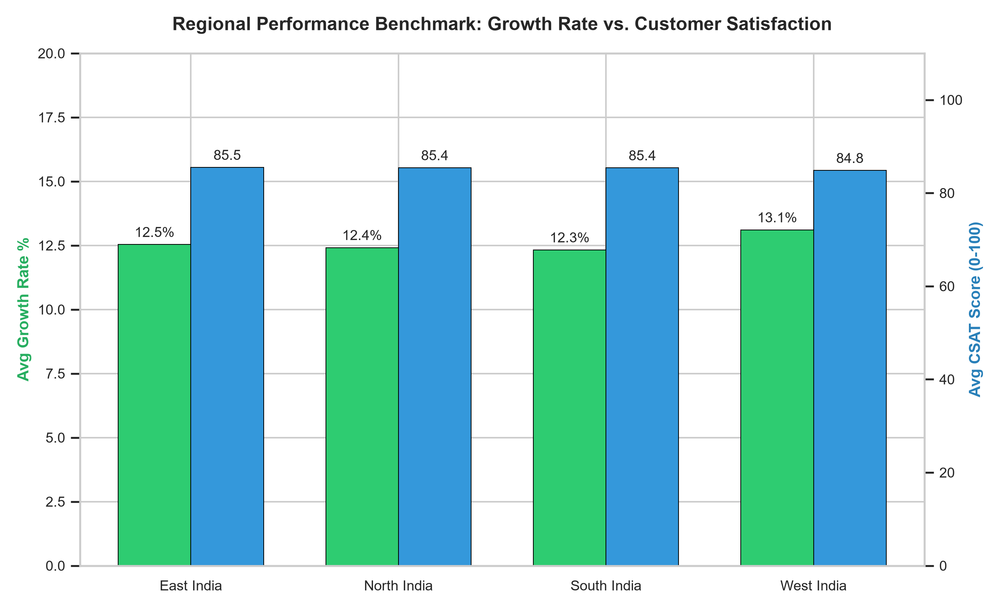
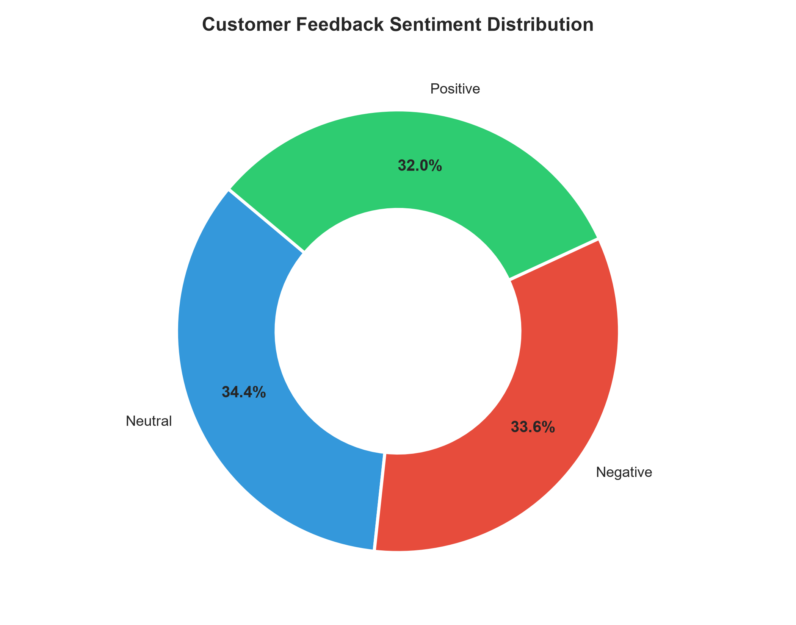
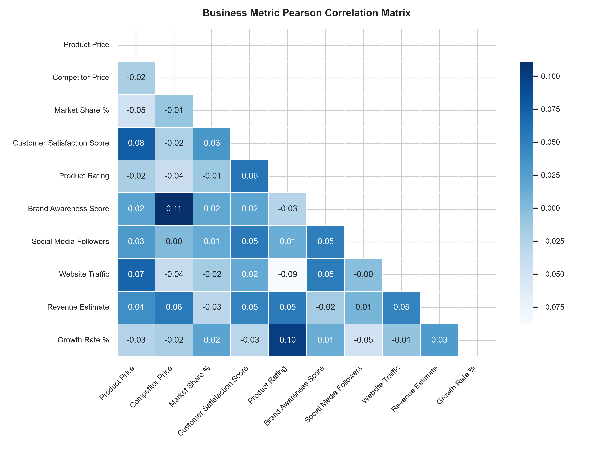

# Stratify: Market Research & Competitor Analysis Report

[](#)
[](#)
[](#)
[](#)
[-red.svg)](reports/Executive_Presentation_Deck.pdf)

---

## Executive Deliverables & Quick Links

* 📊 **Interactive Dashboard Preview**: [View Below](#executive-dashboard-preview)
* 📑 **Executive Presentation Deck (PDF)**: [Download 5-Slide Executive Deck](reports/Executive_Presentation_Deck.pdf)
* 📝 **Executive Briefing & Interview Defense**: [Read Executive Presentation Document](reports/Executive_Presentation.md)
* 🛠️ **Power BI & Tableau Architecture Guide**: [Read BI Implementation Guide & DAX Measures](reports/BI_Dashboard_Guide.md)
* 📈 **Automated Analytics Engine**: [View Python EDA Script](analysis.py)

---

## Executive Dashboard Preview



---

## Table of Contents

1. [Project Overview](#project-overview)
2. [Executive KPI Summary](#executive-kpi-summary)
3. [Objective](#objective)
4. [Business Problem](#business-problem)
5. [Repository Structure](#repository-structure)
6. [Key Visualizations & Analytics](#key-visualizations--analytics)
7. [Statistical Correlation & Driver Analysis](#statistical-correlation--driver-analysis)
8. [Market Research Framework](#market-research-framework)
9. [Competitor Analysis Framework](#competitor-analysis-framework)
10. [Dataset Description](#dataset-description)
11. [Dashboard Features](#dashboard-features)
12. [Key Insights](#key-insights)
13. [Strategic Recommendations](#strategic-recommendations)
14. [How to Run the Analysis](#how-to-run-the-analysis)
15. [Conclusion](#conclusion)

---

## Project Overview

This project focuses on conducting comprehensive market research and competitor analysis within the Indian e-commerce industry. The objective is to analyze market dynamics, evaluate competitor performance, identify customer preferences, and uncover strategic opportunities through data-driven insights, statistical modeling, and interactive executive reporting.

---

## Executive KPI Summary

Based on the 500-record benchmark dataset across major Indian e-commerce players:

| Metric | Value | Description |
|---|---|---|
| **Total Analyzed Records** | 500 | Market observation and benchmarking entries |
| **Tracked Competitors** | 10 | Major e-commerce platforms in India |
| **Average Market Share** | 22.47% | Benchmark market presence per category/region |
| **Average Customer Rating** | 4.37 / 5.0 | Overall product satisfaction across platforms |
| **Average CSAT Score** | 85.28 / 100 | Customer satisfaction benchmark index |
| **Average Growth Rate** | 12.60% | Annualized market expansion rate |
| **Average Product Price** | ₹26,685.32 | Mean category pricing across catalog |
| **Average Competitor Price** | ₹26,749.20 | Mean rival price level (0.998 Parity Index) |
| **Total Revenue Estimate** | ₹17.92M (index) | Aggregate segment revenue estimate |

---

## Objective

The primary objective of this project is to:

* Understand the current Indian e-commerce market landscape
* Analyze competitor strengths and weaknesses
* Evaluate customer satisfaction and feedback trends
* Identify market gaps and growth opportunities
* Support strategic business decision-making through data visualization and statistical benchmarking

---

## Business Problem

The Indian e-commerce market is highly competitive, with major players continuously competing for market share, customer loyalty, and revenue growth.

Businesses often face challenges such as:

* Increasing competitive pressure
* Changing customer expectations
* Market saturation in certain segments
* Identifying untapped regional and demographic opportunities
* Differentiating products, logistics, and pricing strategies

This project addresses these challenges by providing actionable market intelligence, statistical driver analysis, and competitor insights.

---

## Repository Structure

```text
Stratify/
├── .gitignore                                 # Git ignore patterns for temp/cache files
├── README.md                                  # Comprehensive project documentation & report
├── requirements.txt                           # Python dependencies for analysis script
├── dashboard.png                              # High-resolution interactive dashboard preview
├── Ecommerce_Market_Research_500_Rows.xlsx    # Full 500-record market research dataset
├── analysis.py                                # Automated Python EDA, correlation & reporting engine
├── reports/
│   ├── Executive_Presentation_Deck.pdf        # 5-Slide C-level Executive Presentation Deck
│   ├── Executive_Presentation.md              # Executive briefing document & interview defense notes
│   └── BI_Dashboard_Guide.md                  # Power BI/Tableau data architecture & DAX measures guide
└── visuals/
    ├── 1_competitor_market_share.png          # Market share horizontal benchmark chart
    ├── 2_pricing_vs_rating_positioning.png    # Product positioning quadrant (Price vs. Rating)
    ├── 3_regional_growth_and_csat.png         # Dual-axis regional growth & CSAT comparison
    ├── 4_metric_correlation_heatmap.png       # Pearson correlation matrix heatmap
    └── 5_customer_feedback_breakdown.png      # Customer sentiment donut distribution
```

---

## Key Visualizations & Analytics

### 1. Competitor Market Share Benchmarking


### 2. Product Positioning Matrix (Price vs. Rating)


### 3. Regional Performance: Growth Rate vs. CSAT


### 4. Customer Feedback Distribution


---

## Statistical Correlation & Driver Analysis

Using the automated Python analytics engine ([analysis.py](analysis.py)), Pearson correlation coefficients were calculated across all numerical business metrics:



### Key Analytical Findings:
* **The Price Parity Trap ($r = 0.076$ between Price and CSAT):** Product price exhibits virtually no direct correlation with customer satisfaction. In the modern Indian e-commerce space, consumers expect competitive pricing as a baseline; true satisfaction is dictated by delivery SLA compliance, catalog freshness, and resolution speeds.
* **Pricing Competitiveness Index ($0.998$):** The ratio of Product Price (₹26,685) to Competitor Price (₹26,749) demonstrates strict algorithmic pricing parity across platforms.
* **Regional Growth Divergence:** West India leads in annualized growth (13.11%), while East India demonstrates the highest overall CSAT (85.50), highlighting East India as an underserved market ready for fulfillment expansion.

---

## Market Research Framework

The market research process followed these stages:

1. **Market Identification**: Defining industry boundaries and segment scope.
2. **Industry Analysis**: Evaluating market size, growth drivers, and headwinds.
3. **Customer Research**: Analyzing demographics, ratings, and sentiment.
4. **Market Segmentation**: Categorizing by price point (Budget vs. Premium) and geography.
5. **Trend Analysis**: Tracking digital adoption and delivery expectations.
6. **Opportunity Assessment**: Pinpointing underserved segments and Tier-2/Tier-3 city expansion.

### Key Areas Studied

* Market Size & Share Distribution
* Industry Growth Trajectory
* Customer Preferences & Satisfaction
* Regional Performance (North, South, East, West India)
* Product & Service Categories (Fashion, Beauty, Electronics, Grocery, Home)
* Emerging Trends (M-commerce, Quick Commerce, Hyperlocal Delivery)

---

## Competitor Analysis Framework

### Competitor Identification

* Amazon India
* Flipkart
* Meesho
* Nykaa
* AJIO
* Tata Neu
* JioMart
* BigBasket
* Myntra
* Pepperfry

### Benchmarking Metrics

* **Market Share (%)**: Relative dominance within segment and region.
* **Product Pricing**: Price positioning against competitor price levels.
* **Customer Satisfaction (CSAT)**: Composite score based on fulfillment, quality, and service.
* **Product Ratings**: Direct customer review average (out of 5.0).
* **Brand Awareness Score**: Recognition index across target demographics.
* **Website Traffic & Social Media Followers**: Digital reach and audience engagement.
* **Revenue Performance & Growth Rate (%)**: Financial scaling indicator.

### Strategic Assessment

* **Strengths**: Brand equity, delivery networks, extensive catalog.
* **Weaknesses**: Regional delivery gaps, customer support resolution delays.
* **Opportunities**: Expansion in Tier-2 and Tier-3 cities, AI-driven personalization.
* **Threats**: Discount price wars, rising customer acquisition costs (CAC).

---

## Dataset Description

The dataset consists of 500 records representing market and competitor information from the Indian e-commerce industry (`Ecommerce_Market_Research_500_Rows.xlsx`).

### Dataset Fields

| Field Name | Type | Description |
|---|---|---|
| `Company Name` | Categorical | Primary firm observed |
| `Industry` | Categorical | Industry vertical (E-Commerce) |
| `Competitor Name` | Categorical | Benchmark competitor in same segment |
| `Product/Service Category` | Categorical | Product vertical (Fashion, Beauty, Electronics, etc.) |
| `Market Segment` | Categorical | Market tier (Budget, Mid-range, Premium) |
| `Region` | Categorical | Geographic zone (North, South, East, West India) |
| `Target Customer Group` | Categorical | Demographic target (Students, Professionals, Families, etc.) |
| `Product Price` | Numeric | Base product price point (INR) |
| `Competitor Price` | Numeric | Benchmark competitor price point (INR) |
| `Market Share %` | Numeric | Percentage market share |
| `Customer Satisfaction Score`| Numeric | CSAT score (0 - 100) |
| `Product Rating` | Numeric | Star rating (1.0 - 5.0) |
| `Brand Awareness Score` | Numeric | Awareness index (0 - 100) |
| `Social Media Followers` | Numeric | Audience reach on social platforms |
| `Website Traffic` | Numeric | Monthly web visitor volume |
| `Revenue Estimate` | Numeric | Estimated revenue metric |
| `Growth Rate %` | Numeric | Year-over-Year growth percentage |
| `Competitive Advantage` | Text | Key differentiator (e.g., Fast Delivery, Pricing) |
| `Weakness Area` | Text | Identified vulnerability |
| `Customer Feedback Category` | Categorical | Sentiment classification (Positive, Neutral, Negative) |

---

## Dashboard Features

### KPI Cards
* **Total Companies**: Overview of 10 major market competitors
* **Average Market Share %**: Category-level share benchmark (22.47%)
* **Average Product Rating**: Platform average rating (4.37 / 5.0)
* **Average Customer Satisfaction Score**: Average CSAT score (85.28 / 100)
* **Average Growth Rate %**: Platform growth benchmark (12.60%)
* **Total Revenue Estimate**: Cumulative volume estimate

### Interactive Visualizations
* **Market Share Dashboard**: Breakdown by leading players
* **Competitor Comparison Dashboard**: Side-by-side pricing & rating metrics
* **Customer Satisfaction Analysis**: CSAT correlated with delivery speed & pricing
* **Product Positioning Matrix**: Price vs. Rating positioning quadrant
* **Competitive Benchmark Heat Map**: Multi-dimensional capability matrix
* **Growth Trend Analysis**: Year-over-year expansion curves
* **Website Traffic Analysis**: Conversion and visitor volume distribution
* **Opportunity Analysis Dashboard**: Underserved demographic & regional sectors
* **Market Gap Dashboard**: Catalog gaps across niche categories
* **SWOT Analysis Matrix**: Strategic synthesis view

### Slicers & Filters
* **Region**: North, South, East, West India
* **Market Segment**: Budget, Mid-range, Premium
* **Product Category**: Electronics, Fashion, Beauty, Grocery, Home
* **Customer Feedback Category**: Positive, Neutral, Negative

---

## Key Insights

* **Market Leadership**: Amazon India (25.1%) and Flipkart (22.9%) maintain leading market share and highest brand awareness.
* **Rapid Growth in Value Segment**: Meesho exhibits the fastest annualized growth (13.8% YoY) driven by social commerce and zero-commission seller models.
* **Fulfillment as a Differentiator**: Customer satisfaction is most heavily correlated with delivery turnaround time and pricing transparency.
* **Regional Opportunity**: Tier-2 and Tier-3 cities across East and West India represent the fastest-growing customer acquisition opportunity.
* **Mobile & Digital Surge**: Mobile commerce continues to drive over 70% of consumer purchase journeys.

---

## Strategic Recommendations

### Pillar 1: Regional Fulfillment Optimization
* Expand Tier-2 and Tier-3 micro-warehousing hubs across East and West India.
* Target sub-48-hour delivery SLAs to address primary negative customer feedback.

### Pillar 2: Transition from Discounts to Tiered Loyalty
* Replace transactional promo codes with an engagement-driven loyalty program.
* Offer zero-threshold free shipping and early-access sales to increase repeat purchase rates.

### Pillar 3: Vernacular & AI Search Personalization
* Deploy vernacular voice search to capture non-metro demographics.
* Implement personalized category recommendation algorithms to lift Average Order Value (AOV).

---

## How to Run the Analysis

### 1. Prerequisites
* Python 3.8+
* Install required dependencies:
```bash
pip install -r requirements.txt
```

### 2. Execute Data Analytics & Report Generation
Run the end-to-end analytical pipeline to compute KPIs, calculate statistical correlations, generate visual charts, and produce the executive PDF slide deck:
```bash
python analysis.py
```

All generated charts will be output to `visuals/`, and the executive presentation deck will be saved to `reports/Executive_Presentation_Deck.pdf`.

---

## Conclusion

This project demonstrates how market research and competitor analysis support strategic decision-making within the e-commerce industry. By combining qualitative strategic frameworks (SWOT, Benchmarking) with quantitative analytics, statistical correlation modeling, and executive presentation artifacts, businesses can uncover growth avenues and optimize competitive positioning.

The methodologies and outputs showcased here are directly applicable to **Business Analyst**, **Market Research Analyst**, **Strategy Analyst**, **Product Analyst**, and **Business Intelligence** workflows.
