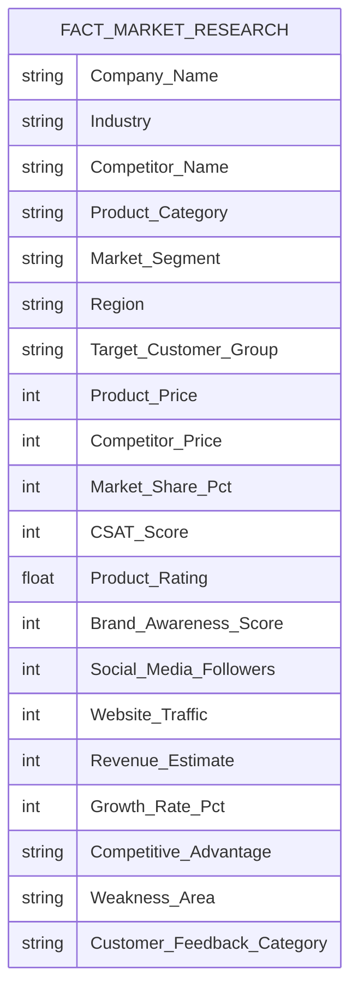

# Business Intelligence Dashboard Implementation Guide: Power BI & Tableau

**Author:** Anwesha Gouda  
**Target Platform:** Microsoft Power BI Desktop / Tableau Desktop  
**Data Source:** `Ecommerce_Market_Research_500_Rows.xlsx`  
**Reference Visual:** `dashboard.png`

---

## 1. Data Architecture & Dimensional Model

The project utilizes a denormalized market research fact table with 500 rows and 20 attributes, which can be modeled in Power BI as a Star Schema or used directly as an analytical dataset.



---

## 2. Core DAX Measures (Power BI)

For Power BI implementation, create a dedicated `_Measures` table with the following DAX calculations:

### 1. Total Market Benchmark Records
```dax
Total Records = COUNTROWS('Market Research Data')
```

### 2. Average Market Share %
```dax
Avg Market Share % = 
DIVIDE(
    SUM('Market Research Data'[Market Share %]),
    COUNT('Market Research Data'[Market Share %])
) / 100
```

### 3. Average Customer Satisfaction (CSAT)
```dax
Avg CSAT = 
AVERAGE('Market Research Data'[Customer Satisfaction Score])
```

### 4. Average Product Rating
```dax
Avg Product Rating = 
AVERAGE('Market Research Data'[Product Rating])
```

### 5. Annualized Growth Rate %
```dax
Avg Growth Rate % = 
DIVIDE(
    AVERAGE('Market Research Data'[Growth Rate %]),
    100
)
```

### 6. Price Competitiveness Parity Index
```dax
Price Parity Index = 
DIVIDE(
    SUM('Market Research Data'[Product Price]),
    SUM('Market Research Data'[Competitor Price])
)
```

### 7. Net Customer Sentiment Score (NSS)
```dax
Net Sentiment Score = 
VAR PositiveCount = CALCULATE(COUNTROWS('Market Research Data'), 'Market Research Data'[Customer Feedback Category] = "Positive")
VAR NegativeCount = CALCULATE(COUNTROWS('Market Research Data'), 'Market Research Data'[Customer Feedback Category] = "Negative")
VAR TotalCount = COUNTROWS('Market Research Data')
RETURN
DIVIDE(PositiveCount - NegativeCount, TotalCount) * 100
```

---

## 3. Visual Layout & Canvas Specifications

Following the layout captured in `dashboard.png`:

### Top Banner: KPI Cards (Single-Value Visuals)
- **Card 1**: Total Analyzed Companies (`10`)
- **Card 2**: Avg Market Share (`22.5%`)
- **Card 3**: Avg Customer Rating (`4.37 / 5.0`)
- **Card 4**: Avg CSAT Index (`85.28 / 100`)
- **Card 5**: Avg Annual Growth (`12.6%`)
- **Card 6**: Total Estimated Revenue (`₹17.92M`)

### Middle Left: Horizontal Bar Chart
- **Visual**: Clustered Horizontal Bar Chart
- **Y-Axis**: `Company Name` (sorted descending by Market Share)
- **X-Axis**: `Avg Market Share %`
- **Data Labels**: Enabled, formatted as percentage

### Middle Right: Scatter Matrix (Product Positioning)
- **Visual**: Scatter Plot
- **X-Axis**: `Product Price` (Continuous)
- **Y-Axis**: `Product Rating` (Continuous, scale 3.5 to 5.0)
- **Legend**: `Market Segment` (Budget, Mid-range, Premium)
- **Reference Lines**: Median Price line and Median Rating line creating 4 quadrants

### Bottom Left: Dual-Axis Clustered Column Chart
- **Visual**: Line and Clustered Column Chart
- **X-Axis**: `Region` (East, North, South, West)
- **Column Y-Axis**: `Avg Growth Rate %`
- **Line Y-Axis**: `Avg CSAT`

### Bottom Right: Donut Chart
- **Visual**: Donut Chart
- **Legend**: `Customer Feedback Category` (Positive, Neutral, Negative)
- **Values**: `Count of Records`
- **Color Palette**: Green (`#2ecc71`), Grey (`#95a5a6`), Red (`#e74c3c`)

---

## 4. Interactive Slicers / Filters Configuration

Configure the following interactive slicer panel on the top or left margin:
1. **Region Slicer**: Tile / Dropdown (North India, South India, East India, West India)
2. **Market Segment Slicer**: Button toggle (Budget, Mid-range, Premium)
3. **Product Category Slicer**: Multi-select dropdown (Fashion, Beauty, Electronics, Grocery, etc.)
4. **Customer Sentiment Slicer**: Single-select toggle (Positive, Neutral, Negative)

---

## 5. Steps to Replicate in Power BI Desktop

1. **Import Data**:
   - Open Power BI Desktop -> `Get Data` -> `Excel Workbook`.
   - Select `Ecommerce_Market_Research_500_Rows.xlsx` -> select `Market Research Data` -> Click `Load`.
2. **Data Type Verification**:
   - In Power Query, confirm numeric columns (`Product Price`, `Market Share %`, `Customer Satisfaction Score`, `Product Rating`, `Growth Rate %`) are set to Whole Number or Decimal Number.
3. **Create DAX Measures**:
   - Click `New Measure` and paste the DAX definitions listed in Section 2.
4. **Build Visuals**:
   - Follow the canvas layout specifications in Section 3 and align with `dashboard.png`.
5. **Publish**:
   - Click `Publish` -> Select workspace in Power BI Service -> Generate a Public or Organization share link to include in your portfolio.
